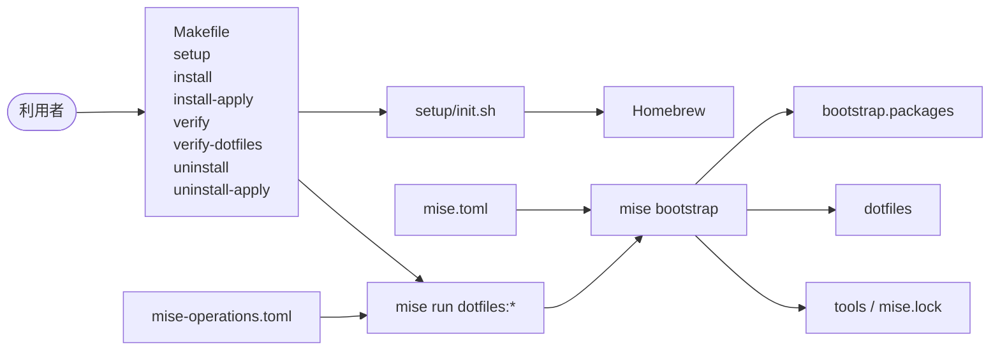

# 構成

## 処理の流れ

利用者はリポジトリルートの Makefile から操作します。`setup` は直接スクリプトを実行し、それ以外の操作は `mise-operations.toml` のタスクを呼び出します。タスクから Makefile は呼びません。

### mise bootstrap の前処理
`setup` は mise bootstrap の実行に必要な Homebrew と mise 本体を準備します。bootstrap 自体は実行しません。

### mise bootstrap

`mise-operations.toml` のタスクが、管理対象を宣言した `mise.toml` を指定して bootstrap を呼び出します。コマンドごとの操作は[使い方](USAGE.md)を参照してください。

## 設定とリンク

ルートの `mise.toml` が bootstrap の宣言元です。`[dotfiles]` は、この設定ファイルと同じディレクトリにある `.bashrc`、`.bash_profile`、`.gitconfig` と `mise.toml` を symlink します。リンク元には相対パスを使い、任意の clone 先から適用できます。`~/.dotfiles` も checkout へのリンクとして管理し、Git フックは `~/.dotfiles/git/hooks` を参照します。

`[bootstrap.packages]` は Homebrew の `git` を管理します。開発ツールは `[tools]` と `mise.lock` で管理します。secretlint のグローバル Git hook はこのリポジトリの `git/hooks/pre-commit` にあり、Docker イメージのバージョンと digest を固定しています。Git Credential Manager は端末ごとに導入し、Git 設定を `~/.gitconfig.local` に保存します。手順は [GCM の設定](GIT-CREDENTIAL-MANAGER.md)を参照してください。

## ファイルの役割

| ファイル | 役割 |
| --- | --- |
| [setup/init.sh](../setup/init.sh) | Homebrew、checkout の確認、mise の準備 |
| [Makefile](../Makefile) | setup と mise タスクを呼び出すエントリポイント |
| [mise.toml](../mise.toml) | パッケージ、dotfile、開発ツールの宣言 |
| [mise-operations.toml](../mise-operations.toml) | 導入・解除・状態確認・テストのタスクと、操作用の設定 |
| [git/hooks/pre-commit](../git/hooks/pre-commit) | 固定イメージを使うグローバル secretlint hook |
| [setup/mise-install.sh](../setup/mise-install.sh) | 固定バージョンの mise を checksum 検証付きで導入 |

## 失敗時の処理

mise bootstrap は宣言された処理を順に適用します。途中で失敗すると、それまでに完了した処理は残ります。一括で元に戻す処理や、独自の事前検査は行いません。

復旧手順は[トラブルシューティング](TROUBLESHOOTING.md)、解除の範囲と操作は[使い方](USAGE.md#解除)を参照してください。
