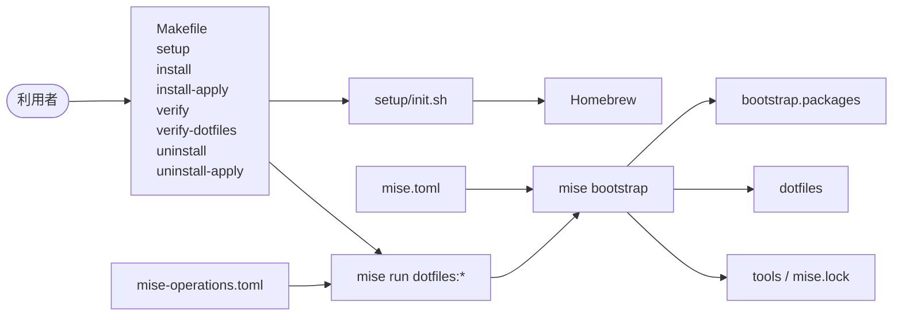

# Architecture

## Workflow

利用者はリポジトリルートの Makefile から操作します。`setup` は直接スクリプトを実行し、それ以外の操作は `mise-operations.toml` のタスクを呼び出します。タスクから Makefile は呼びません。

### Bootstrap Prerequisites

`setup` は mise bootstrap の実行に必要な Homebrew と mise 本体を準備します。bootstrap 自体は実行しません。

### mise bootstrap

`mise-operations.toml` のタスクが、管理対象を宣言した `mise.toml` を指定して bootstrap を呼び出します。コマンドごとの操作は[使い方](USAGE.md)を参照してください。

## Managed Files and Tools

- `.bashrc`、`.bash_profile`、`.gitconfig`
- `~/.codex/config.toml` の共通の権限設定（マージ）
- `~/.codex/agents/code-analysis.toml` の調査専用サブエージェント定義（コピー）
- `~/.dotfiles`（実際の checkout へのリンク。Git フックはこのリンク経由で参照）
- `~/.config/mise/config.toml`（リポジトリルートの `mise.toml` へのリンク）
- `~/.agents/skills/` のリポジトリ管理スキル（Codex もこの場所から読み込みます）
- mise の `[bootstrap.packages]` に宣言した Homebrew パッケージ
- `mise.lock` に記録した開発ツール

## Configuration and Symlinks

ルートの `mise.toml` が bootstrap の宣言元です。`[dotfiles]` は、この設定ファイルと同じディレクトリにある `.bashrc`、`.bash_profile`、`.gitconfig`、`mise.toml`、`.agents/skills/` の各スキルを symlink します。リンク元には相対パスを使い、任意の clone 先から適用できます。`~/.dotfiles` も checkout へのリンクとして管理し、Git フックは `~/.dotfiles/git/hooks` を参照します。

`[bootstrap.packages]` は Homebrew の `git` を管理します。開発ツールは `[tools]` と `mise.lock` で管理します。Git フックの動作と必要な環境は[トラブルシューティング](TROUBLESHOOTING.md#pre-commit-hook-failures)を参照してください。Git Credential Manager は端末ごとに導入し、Git 設定を `~/.gitconfig.local` に保存します。手順は [GCM の設定](GIT-CREDENTIAL-MANAGER.md)を参照してください。

## Shell Startup Configuration

対話 Bash は `.bashrc` から共通設定を読み、OS ごとの設定を適用します。
ログインシェルでは `.bash_profile` が `.bashrc` を読み込みます。

| 環境 | OS ごとの読み込み順 | 設定する内容 |
| --- | --- | --- |
| Linux（WSL を含む） | `bash/linux.bash` | dircolors、lesspipe、Homebrew、mise、direnv |
| WSL のみ | Linux 共通処理の後に `bash/wsl.bash` | SSH agent の起動・再利用、WSL 用の鍵の自動追加 |
| macOS | `bash/mac.bash` | Homebrew、mise、direnv |

Homebrew、mise、direnv はこの順でシェルから利用できるようにします。未導入のツールは読み飛ばします。
最後に `~/.bashrc.local` を読み込み、端末固有の設定を適用します。

SSH agent の起動・再利用と鍵の自動追加は WSL のみ対応しています。
通常の Linux と macOS では、この dotfiles による自動設定は未対応です。
必要な場合は、端末側の設定や `~/.bashrc.local` で対応してください。

## File Responsibilities

| ファイル | 役割 |
| --- | --- |
| [setup/init.sh](../setup/init.sh) | Homebrew、checkout の確認、mise の準備 |
| [Makefile](../Makefile) | setup と mise タスクを呼び出すエントリポイント |
| [mise.toml](../mise.toml) | パッケージ、dotfile、開発ツールの宣言 |
| [mise-operations.toml](../mise-operations.toml) | 導入・解除・状態確認・テストのタスクと、操作用の設定 |
| [git/hooks/pre-commit](../git/hooks/pre-commit) | 固定イメージを使うグローバル secretlint hook |
| [setup/mise-install.sh](../setup/mise-install.sh) | 固定バージョンの mise を checksum 検証付きで導入 |

## Failure Handling

mise bootstrap は宣言された処理を順に適用します。途中で失敗すると、それまでに完了した処理は残ります。一括で元に戻す処理や、独自の事前検査は行いません。

復旧手順は[トラブルシューティング](TROUBLESHOOTING.md)、解除の範囲と操作は[使い方](USAGE.md#uninstall)を参照してください。
